# Demo — Klaten Chicken Soup Jakarta Street

Screenshot semua halaman aplikasi warung sop ayam: pemesanan menu lewat QR meja, layar kasir, dan dashboard pemilik. Ada dua aplikasi web:

- **Dashboard Kasir & Pemilik** (`apps/web`, lokal: http://localhost:3000), untuk staf yang sudah login.
- **Menu QR pelanggan** (`apps/qr-menu`, lokal: http://localhost:3002/?meja=01), dibuka dari HP lewat scan QR meja tanpa akun.

Klik foto untuk melihat ukuran penuh. Semua halaman diambil dari aplikasi yang berjalan dengan data asli database pengembangan.

## Dashboard Kasir & Pemilik

| Foto                                                                                                                             | Penjelasan                                                                                                                                                                                                                                                          |
| -------------------------------------------------------------------------------------------------------------------------------- | ------------------------------------------------------------------------------------------------------------------------------------------------------------------------------------------------------------------------------------------------------------------- |
| <a href="web/01-masuk.webp">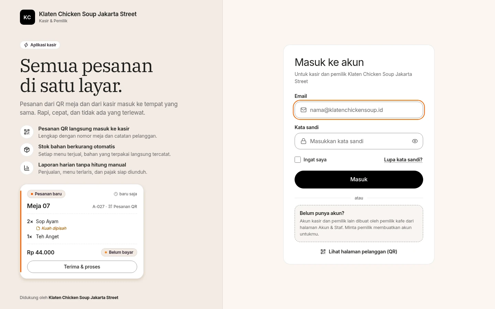</a>                                            | **Masuk**  Halaman login untuk kasir dan pemilik. Panel kiri menjelaskan fitur utama: pesanan QR langsung masuk ke kasir, stok bahan berkurang otomatis, dan laporan harian.                                                                                  |
| <a href="web/02-daftar-pemilik.webp">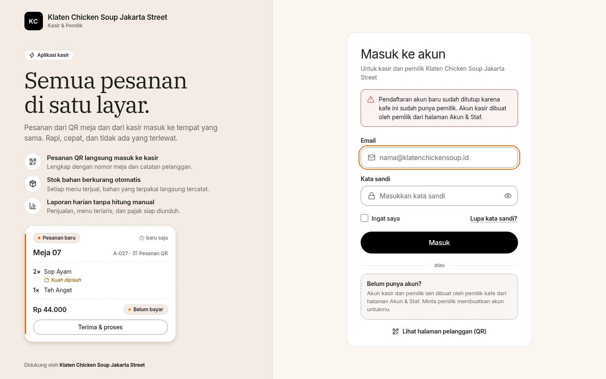</a>                 | **Daftar pemilik**  Pendaftaran hanya dibuka untuk akun pertama, yang otomatis menjadi **Pemilik**. Setelah itu pendaftaran ditutup dan akun kasir dibuat dari halaman _Akun & Staf_.                                                                         |
| <a href="web/03-pesanan.webp">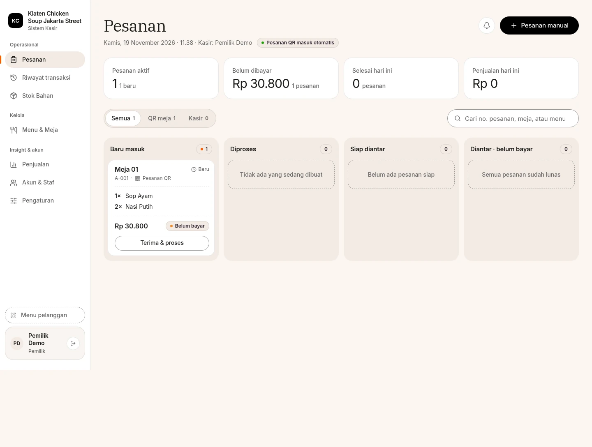</a>                        | **Pesanan (papan kasir)**  Papan pesanan langsung dengan kolom **Baru masuk → Diproses → Siap diantar → Diantar · belum bayar**. Pesanan dari QR meja masuk otomatis, lengkap dengan ringkasan pesanan aktif, belum dibayar, selesai, dan penjualan hari ini. |
| <a href="web/04-pesanan-detail.webp">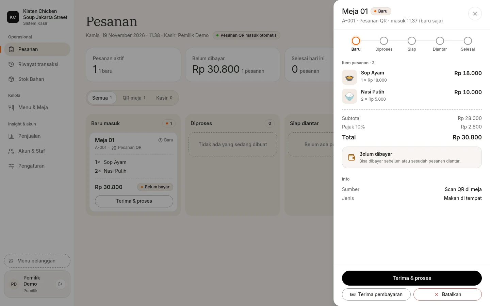</a>                 | **Detail pesanan**  Laci detail satu pesanan: timeline status, daftar item dan catatan, total dengan pajak, lalu tombol **Terima & proses**, terima pembayaran, atau batalkan.                                                                                |
| <a href="web/05-pesanan-manual.webp">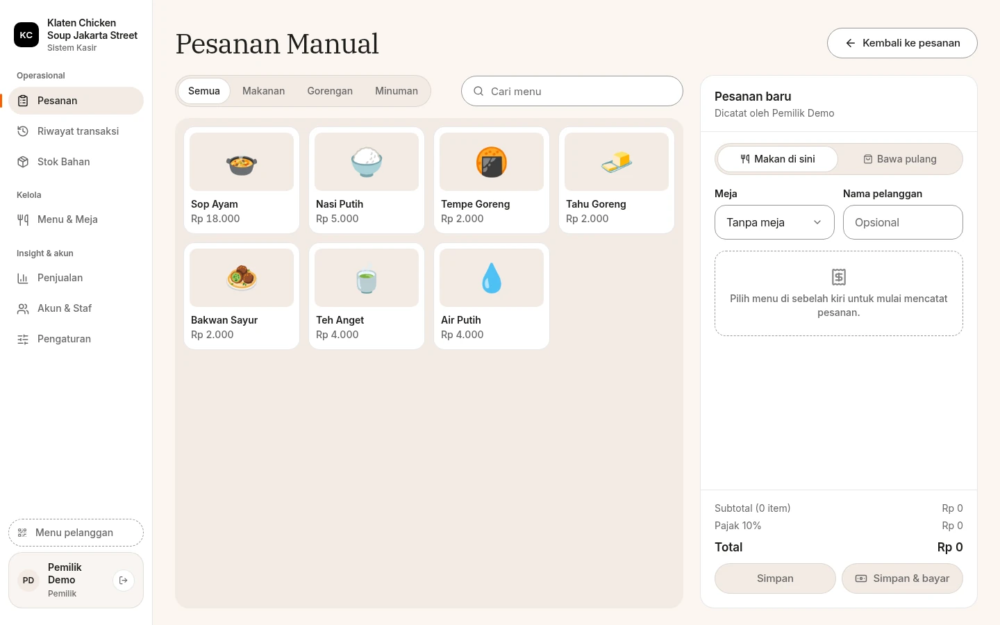</a>                 | **Pesanan manual**  Kasir mencatat pesanan langsung (makan di tempat atau dibungkus) dari grid menu, memilih meja atau nama pelanggan, lalu menyimpan atau langsung membayar.                                                                                 |
| <a href="web/06-pembayaran.webp">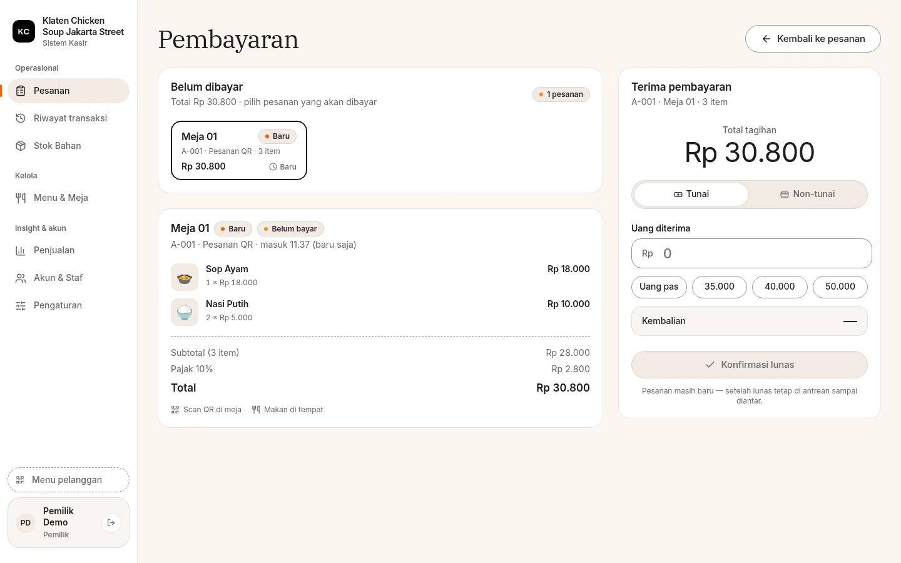</a>                             | **Pembayaran**  Pilih pesanan yang belum dibayar, bayar **tunai** (uang pas, nominal cepat, kembalian otomatis) atau **non-tunai**, konfirmasi lunas, lalu cetak struk.                                                                                       |
| <a href="web/07-riwayat-transaksi.webp">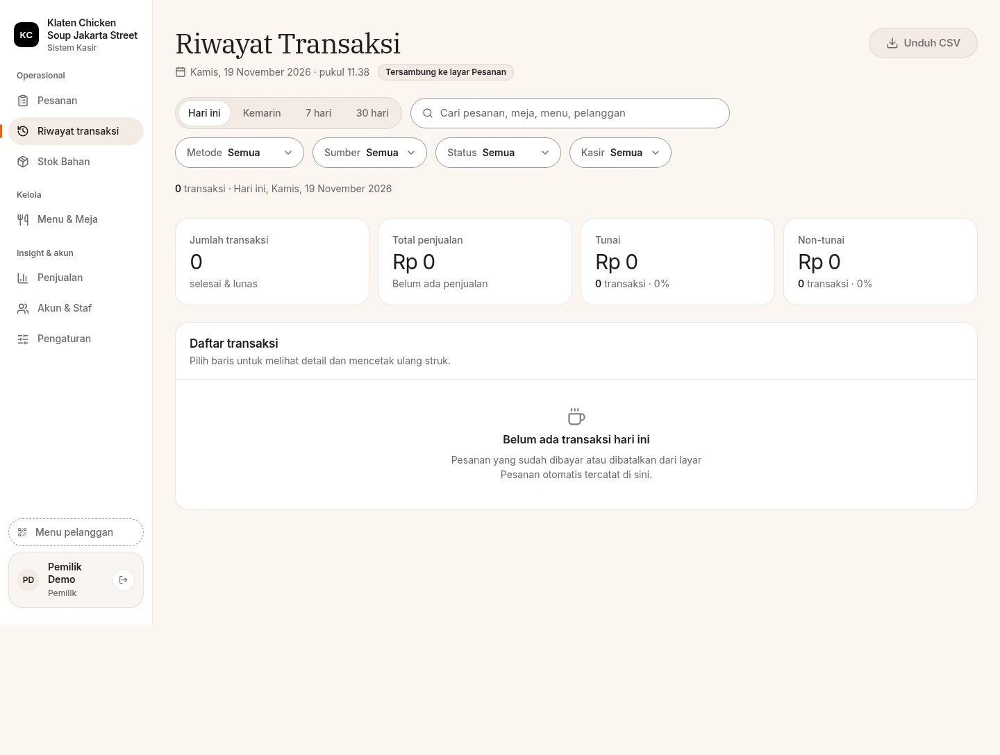</a>        | **Riwayat transaksi**  Semua transaksi per hari atau rentang tanggal, dengan filter metode bayar, sumber (QR/manual), status, dan kasir. Ada ringkasan total, detail per transaksi, dan **Unduh CSV**.                                                        |
| <a href="web/08-stok-bahan.webp">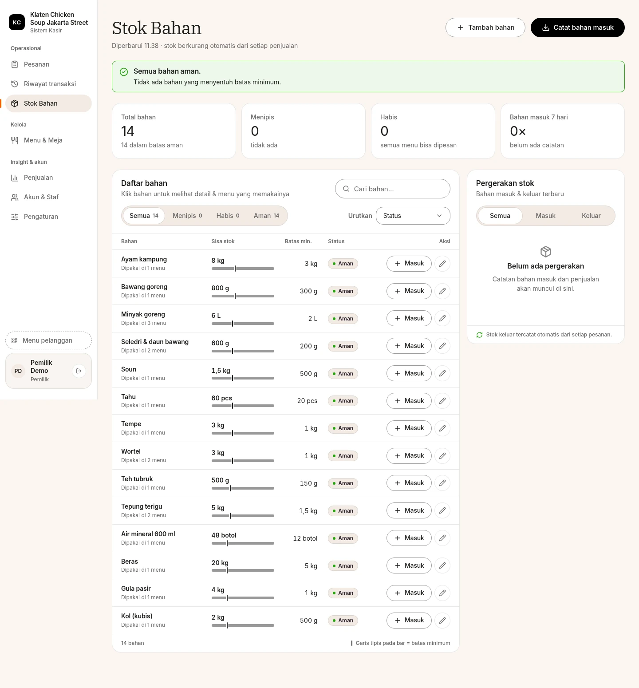</a>                             | **Stok bahan**  Daftar bahan dengan status **Aman / Menipis / Habis**, catat bahan masuk, penyesuaian stok, dan riwayat pergerakan. Stok berkurang otomatis sesuai resep setiap menu terjual.                                                                 |
| <a href="web/09-menu-meja-menu.webp">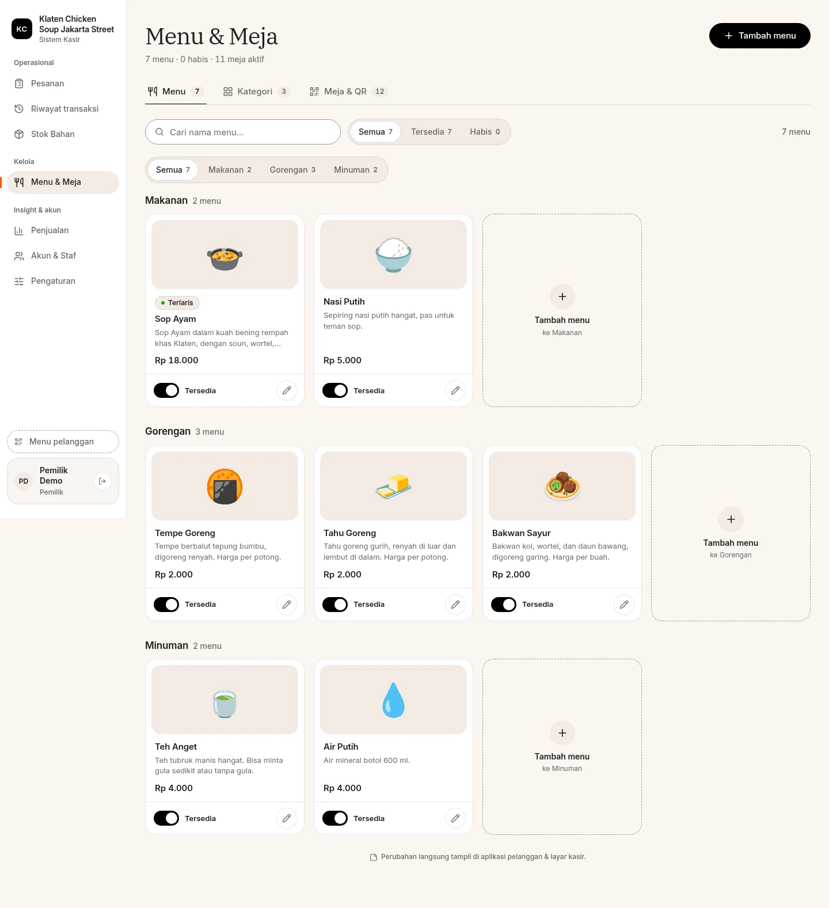</a>             | **Menu & Meja · Menu**  Kelola menu per kategori dengan saklar **Tersedia/Habis**, pencarian, filter, dan peringatan bila bahan resep habis.                                                                                                                  |
| <a href="web/10-menu-meja-tambah-menu.webp">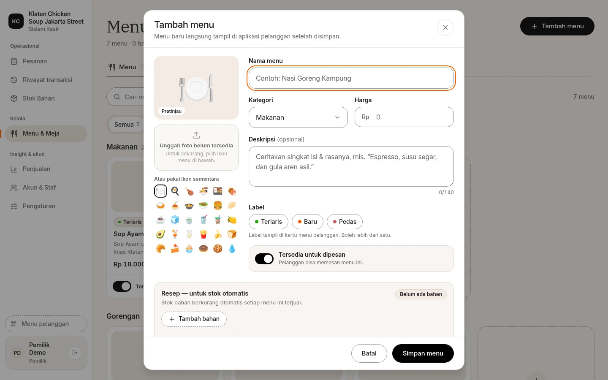</a>      | **Tambah menu**  Form menu: nama, kategori, harga, deskripsi, label (Terlaris/Baru/Pedas), ikon, dan **resep bahan per porsi** untuk stok otomatis, termasuk perkiraan sisa porsi.                                                                            |
| <a href="web/11-menu-meja-kategori.webp">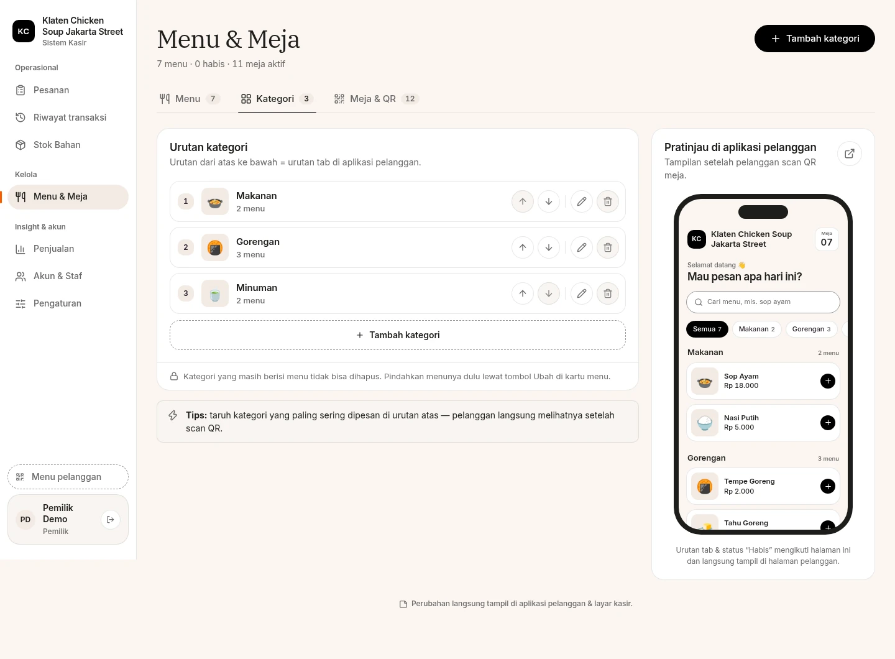</a> | **Menu & Meja · Kategori**  Atur urutan kategori dan lihat langsung pratinjau tampilan di aplikasi pelanggan.                                                                                                                                                 |
| <a href="web/12-menu-meja-meja-qr.webp">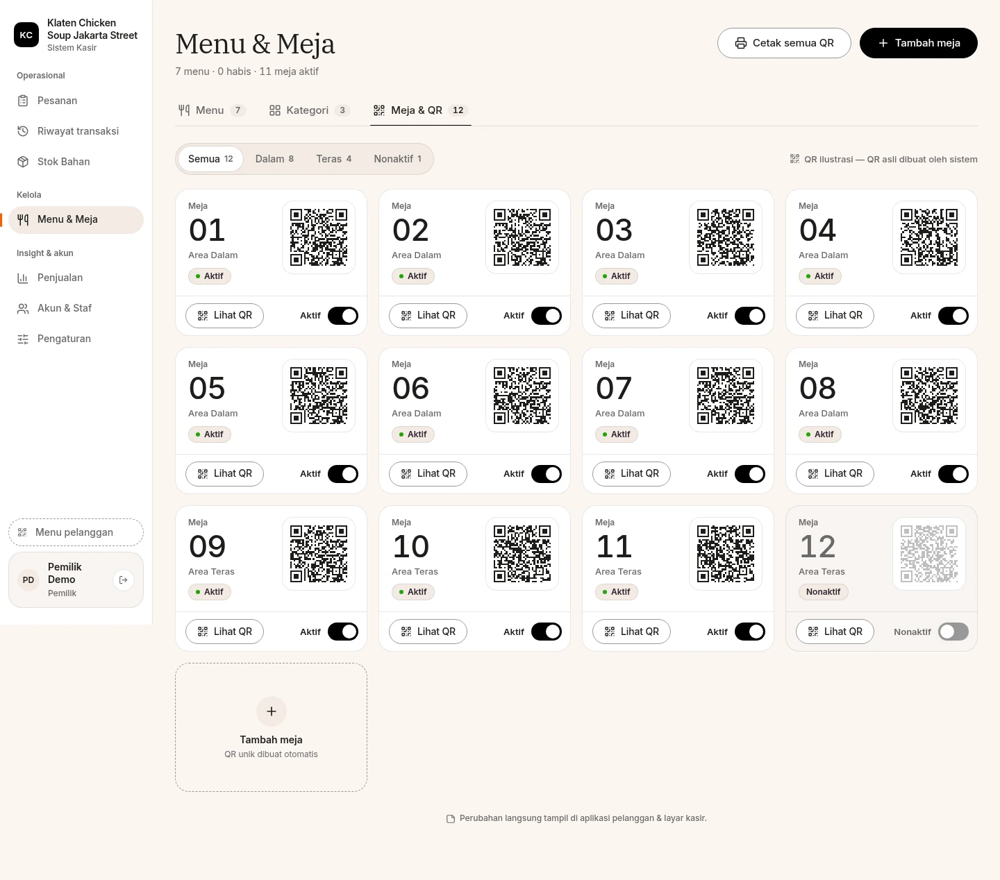</a>  | **Menu & Meja · Meja & QR**  Daftar meja per area dengan QR masing-masing: lihat dan cetak QR, cetak semua sekaligus, serta aktif/nonaktifkan meja.                                                                                                           |
| <a href="web/13-penjualan.webp">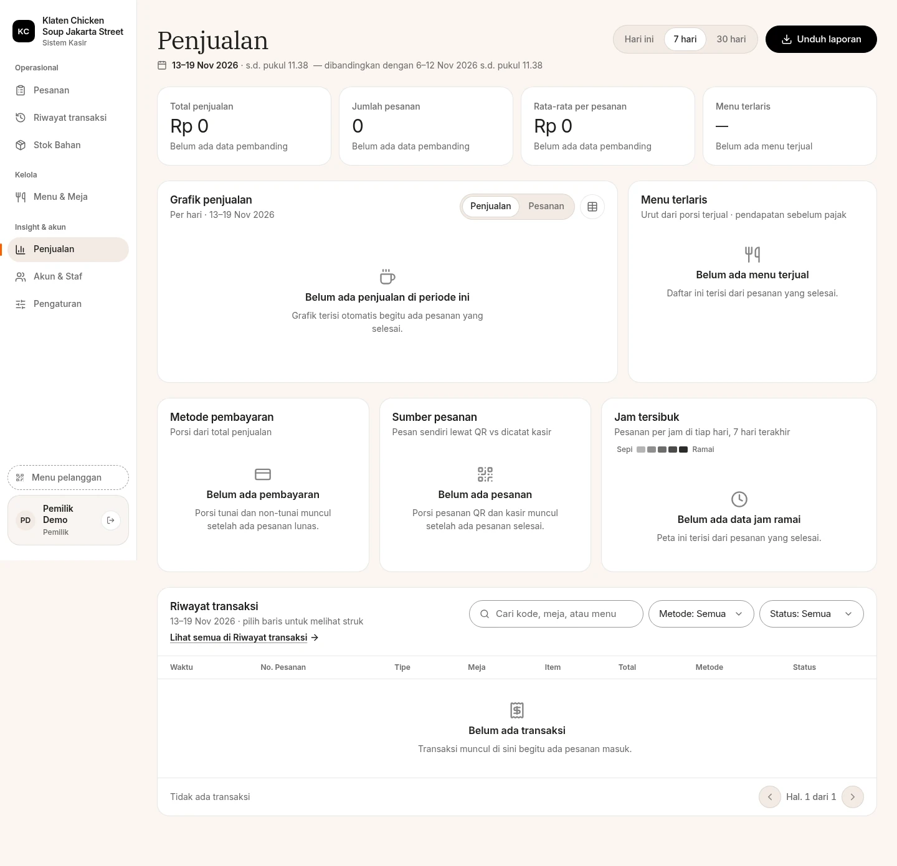</a>                                | **Penjualan**  Dashboard pemilik berisi total penjualan, jumlah pesanan, rata-rata per pesanan, grafik per hari/jam, menu terlaris, metode pembayaran, sumber pesanan, jam ramai, dan unduh laporan.                                                          |
| <a href="web/14-akun-staf.webp">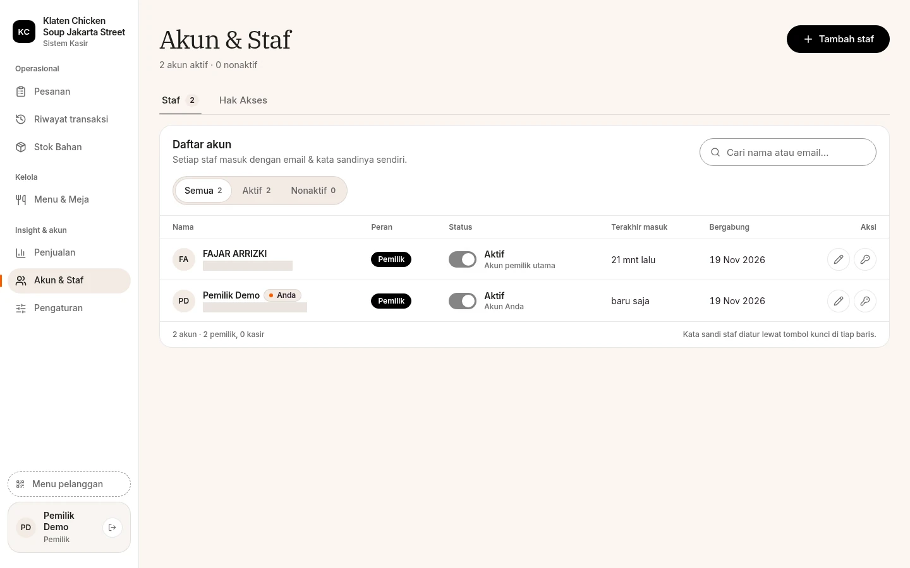</a>                              | **Akun & Staf**  Kelola akun kasir dan pemilik (tambah, nonaktifkan, ganti kata sandi) serta **hak akses kasir**. Email akun disamarkan di screenshot ini.                                                                                                    |
| <a href="web/15-pengaturan.webp">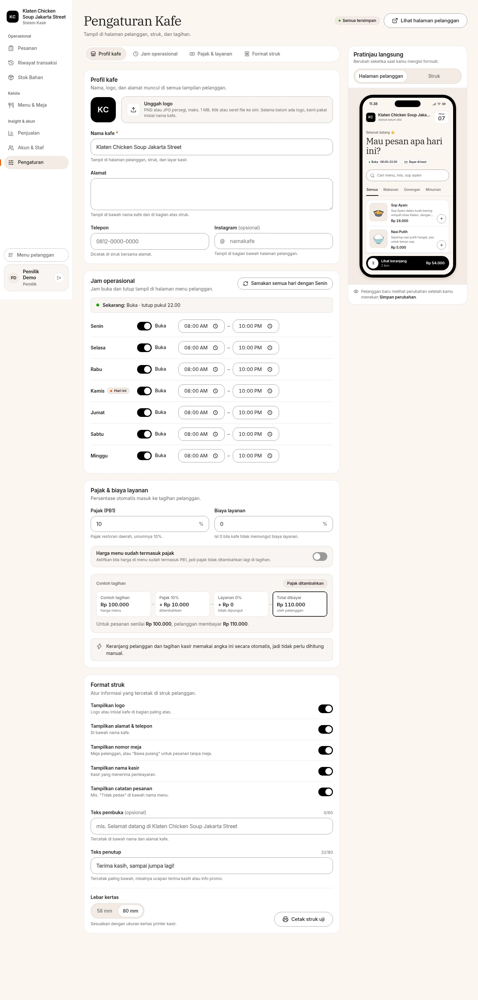</a>                             | **Pengaturan**  Profil kafe (logo, nama, alamat, kontak), jam operasional, pajak & layanan, dan format struk, dengan **pratinjau langsung** di aplikasi pelanggan dan struk.                                                                                  |

## Menu QR pelanggan (HP)

| Foto                                                                                                                                 | Penjelasan                                                                                                                                                                   |
| ------------------------------------------------------------------------------------------------------------------------------------ | ---------------------------------------------------------------------------------------------------------------------------------------------------------------------------- |
| <a href="qr/01-beranda-menu.webp">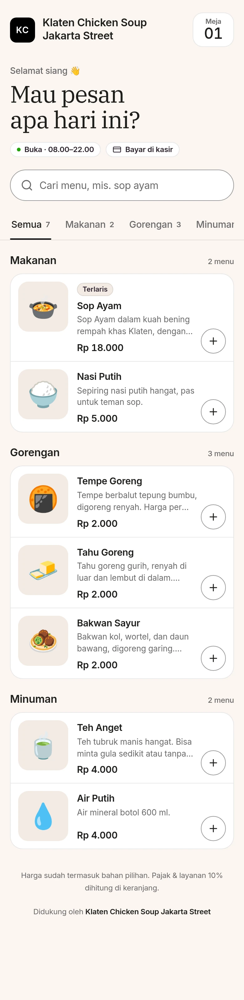</a>                             | **Beranda menu**  Terbuka saat pelanggan scan QR meja (`/?meja=01`): nama kafe, nomor meja, status buka, pencarian, tab kategori, dan daftar menu dengan tombol **+**. |
| <a href="qr/02-detail-menu.webp">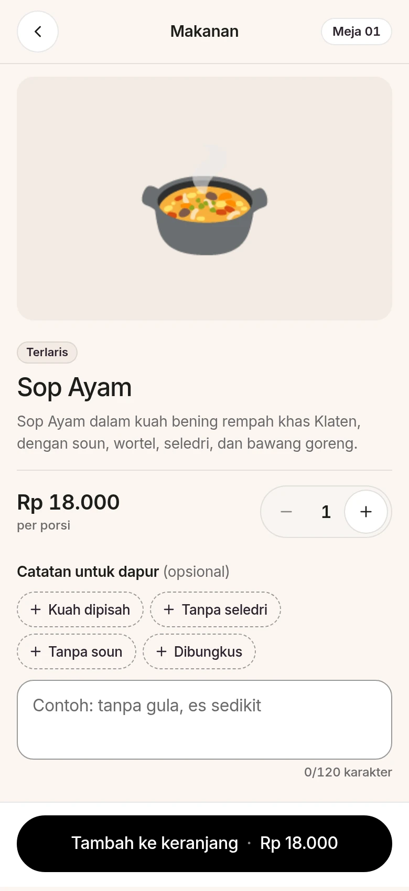</a>                                | **Detail menu**  Deskripsi menu, atur jumlah, dan **catatan cepat untuk dapur**, lalu tambah ke keranjang.                                                             |
| <a href="qr/03-beranda-keranjang-terisi.webp">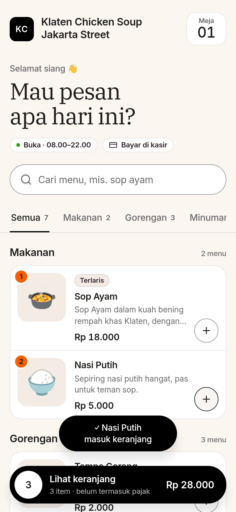</a> | **Keranjang terisi**  Setelah menambah menu, bar keranjang muncul di bawah dengan jumlah item dan subtotal.                                                            |
| <a href="qr/04-keranjang.webp">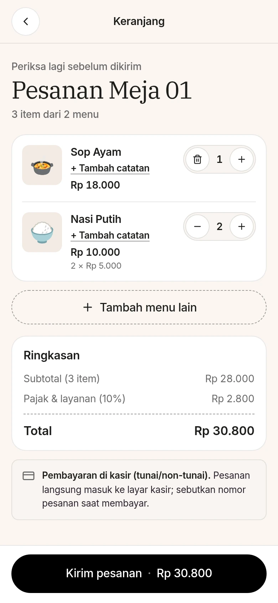</a>                                      | **Keranjang**  Cek ulang pesanan: ubah jumlah, tambah catatan, lihat subtotal, pajak & layanan, lalu **Kirim pesanan**.                                                |
| <a href="qr/05-status-pesanan.webp">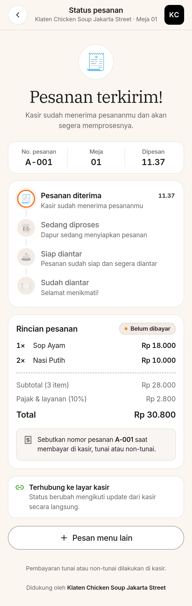</a>                       | **Status pesanan**  Setelah dikirim: nomor pesanan, timeline status yang ikut berubah saat kasir memproses, rincian dan total, serta instruksi bayar di kasir.         |
| <a href="qr/06-qr-tidak-valid.webp">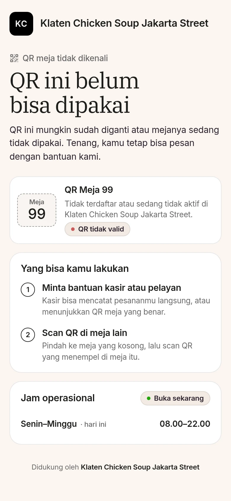</a>                       | **QR tidak valid**  Muncul bila QR meja tidak dikenal atau mejanya dinonaktifkan, beserta arahan minta bantuan kasir dan jam operasional.                              |

## Catatan

- Pesanan pada screenshot dikirim sungguhan dari Menu QR (Meja 01), sehingga papan kasir, detail pesanan, pembayaran, dan status pesanan berisi data nyata.
- Login dashboard memakai akun pemilik sementara **Pemilik Demo** yang sudah dihapus setelah screenshot diambil, dan email akun disamarkan.
- Halaman **Kafe tutup** (`/tutup`) hanya muncul di luar jam operasional, jadi tidak ikut di-screenshot.
